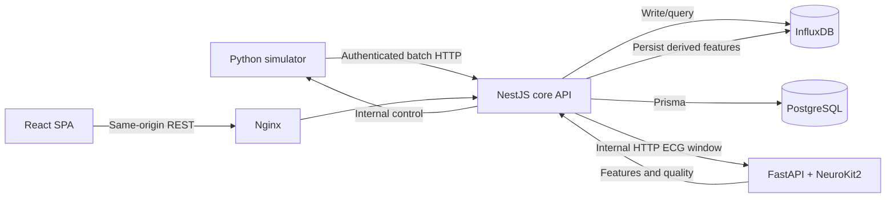

# AEGIS — Especificación técnica e instrucciones de implementación para Codex

**Actualización arquitectónica 14/11/2026:** interfaz integral AEGIS según docs/DECISIONS.md (ADR-001). No aplicaciones gráficas externas; único punto de acceso Nginx, frontend → NestJS → servicios internos.

**Documento 2 de 2 | Objetivo:** construir y ejecutar la primera instancia funcional en el directorio de trabajo actual. Leer antes `01_AEGIS_CONTEXTO_INVESTIGACION.md`.

## 1. Mandato de implementación

Actúa como arquitecto full-stack, ingeniero de datos y desarrollador de sistemas de telemetría. Implementa un MVP ejecutable, no solo una planificación. Inspecciona primero el directorio, archivos y herramientas existentes; conserva trabajo ajeno, no borres datos ni modifiques repositorios externos. Crea el proyecto independiente AEGIS siguiendo esta especificación y el contexto científico. Si hay conflictos, registra decisiones y escoge la opción más simple que preserve seguridad y flujo funcional. Trabaja en español; identificadores técnicos en inglés e interfaz inicial en inglés para exposición internacional. No publiques, no hagas push ni configures dominio externo sin permiso.

Prioridad absoluta: un flujo vertical real, desde simulador → API → InfluxDB → procesamiento NeuroKit2 → API → React, y eventos persistidos en PostgreSQL. No implementar once pantallas vacías ni dejar una maqueta como resultado. Si falta tiempo, completar las etapas prioritarias y declarar claramente lo pendiente.

## 2. Decisiones tecnológicas

| Capa | Tecnología | Justificación |
|---|---|---|
| Frontend | React, TypeScript, Vite, Tailwind CSS, React Router, TanStack Query, Lucide | Patrón conocido de LATEX; control total de interfaz |
| Gráficos | Apache ECharts con Canvas para ECG y tendencias; Recharts opcional solo si ya se usa | Evitar rendering de miles de nodos SVG; no instalar dos librerías sin necesidad |
| Core API | NestJS modular, DTO con class-validator, Swagger/OpenAPI, JWT, Prisma | Único contrato público, lógica de negocio y autorización |
| Relacional | PostgreSQL 16 | Identidades, eventos, reglas, configuraciones, roles |
| Series de tiempo | InfluxDB OSS 2.7.x (compatibilidad con Flux y cliente JS) | Medidas continuas y features sin duplicarlas en Postgres |
| Analítica | Python 3.11, FastAPI, NeuroKit2, NumPy | Servicio interno de bioseñales; sin LLM ni ML obligatorio |
| Simulación | Python, NeuroKit2, HTTP con reintentos | Productor independiente de muestras, control vía Core API |
| Infraestructura | Docker Compose v2, Nginx | Instalación on-premise y operación local |

Seleccionar versiones estables compatibles y fijar dependencias y tags de imágenes concretos, nunca `latest`. Verificar compatibilidad con el entorno disponible, especialmente Python/NumPy/NeuroKit2. No interpretar estas versiones de referencia como obligación de utilizar releases inseguras. Registrar lockfiles y versión probada. InfluxDB 2 se elige deliberadamente por continuidad técnica con LATEX; no es una afirmación de que sea la última generación.

## 3. Arquitectura y límites



API central debe ser dueña de escritura de datos y estado operacional; Python devuelve resultados, no administra usuarios ni eventos. Toda visualización y configuración se integra en React/ECharts; no dashboards externos ni iframes. El frontend solo consume NestJS. No exponer puertos de PostgreSQL, InfluxDB ni FastAPI al exterior; solo Nginx en localhost inicialmente. MQTT/Node-RED son adaptadores futuros, no dependencias del MVP. En ejecución local, evitar CDN, fuentes remotas y APIs cloud. La construcción inicial sí puede requerir Internet para descargar paquetes e imágenes.

## 4. Estructura propuesta

```text
AEGIS/
  AGENTS.md
  README.md
  .env.example
  .gitignore
  docker-compose.yml
  apps/
    backend/
      prisma/{schema.prisma,migrations/,seed.ts}
      src/{common/,config/,modules/}
      Dockerfile
      package.json
    frontend/
      src/{app/,features/,shared/,assets/}
      Dockerfile
      package.json
  services/
    analytics/{app/,tests/,Dockerfile,requirements.txt}
    simulator/{app/,scenarios/,tests/,Dockerfile,requirements.txt}
  infra/
    nginx/
    influxdb/

  datasets/{synthetic/,nasa/,SOURCES.md}
  docs/{ARCHITECTURE.md,DATA_MODEL.md,TELEMETRY.md,SCIENTIFIC_EVIDENCE.md,VALIDATION.md,ROADMAP.md,releases/}
  tests/e2e/
```

Evitar directorios sin propósito; documentación mínima útil desde inicio. Mantener los dos documentos fuente en `docs/` si ya están en el directorio, sin modificarlos silenciosamente. AGENTS.md debe exigir DTOs, autorización, migraciones, documentación, pruebas por riesgo, notas de versiones y prohibición de datos médicos reales en demo. No copiar configuraciones de LATEX ni dependencias privadas. Verificar licencia de componentes antes de añadir `LICENSE`; proponer MIT para código original si el titular lo confirma.

## 5. Modelo PostgreSQL / Prisma

Usar UUID, referencias explícitas, fechas UTC, restricciones únicas e índices. Modelo inicial (nombres orientativos, implementar relaciones necesarias):

| Entidad | Campos y reglas esenciales |
|---|---|
| Mission | id, code unique, name, startAt, status |
| CrewMember | id, missionId, code, displayName ficticio, role; unique(missionId,code) |
| Habitat | id, missionId, code, name |
| Device | id, missionId, code, crewMemberId o habitatId (uno), kind, status, lastSeenAt |
| MetricDefinition | key unique, unit, scope, expectedIntervalMs, staleAfterMs, category |
| User | id, username unique, passwordHash, role, crewMemberId opcional, enabled |
| HealthBaseline | crewMemberId, metricKey, context, center, spread, window, method, version, createdAt; histórico de versiones |
| AlertRule | id, metricKey, version, deviationPercent, sustainSeconds, enabled, demoOnly |
| HealthEvent | id, missionId, crewMemberId nullable, habitatId nullable, type, severity, status, firstObservedAt, lastObservedAt, ruleVersion, evidence JSON, dedupKey, acknowledgedAt, resolvedAt |
| HealthCheckIn | id, crewMemberId, createdBy, recordedAt, fatigueScore opcional, sleepHours opcional, notes |
| SimulationRun | id, missionId, scenario, seed, status, startedAt, stoppedAt, config JSON |
| AuditLog | id, actorId o serviceId, action, entityType, entityId, createdAt, metadata mínima |
| EvidenceSource | id, title, url, datasetId opcional, license, provenance, reviewedAt |

Estados de eventos: OPEN → ACKNOWLEDGED → RESOLVED. Reconocer no equivale a resolver. Guardar actor y nota de resolución; no eliminar eventos por defecto. Evitar duplicados mediante clave de episodio y garantía transaccional (índice único apropiado). Mantener una referencia al baseline y fotografía de valores evaluados. No almacenar payload continuo por muestra en PostgreSQL. Semillas idempotentes: misión ARES-01, cuatro perfiles ficticios, dispositivos y catálogo; no resetear una base persistente al arrancar.

Roles MVP: ADMIN técnico, MEDICAL_OFFICER simulado, CREW (propios datos), DEMO_VIEWER solo lectura de datos sintéticos. Validar permisos y alcance en backend para cada ruta; la interfaz no es frontera de seguridad. Crear cuentas demo locales a partir de variables de entorno y documentar cómo iniciar sesión. Nunca usar contraseñas reales del usuario ni versionar secretos.

## 6. Contrato de telemetría

### 6.1 Métricas escalares

`POST /api/v1/telemetry/ingest` con un lote acotado (p. ej. 1000 muestras máximo, límite de cuerpo explícito):

```json
{
  "schemaVersion": 1,
  "batchId": "demo-000001",
  "missionId": "<uuid>",
  "deviceId": "<uuid>",
  "source": "SIMULATED",
  "samples": [
    {"metric": "heart_rate", "value": 72.0, "unit": "bpm", "observedAt": "2026-11-14T15:00:00.000Z", "quality": "GOOD"},
    {"metric": "spo2", "value": 98.0, "unit": "%", "observedAt": "2026-11-14T15:00:00.000Z", "quality": "GOOD"}
  ]
}
```

Derivar tripulante/hábitat de asignación autorizada del dispositivo, no confiar en un ID arbitrario enviado por cliente. Validar existencia, unidad canónica, número finito, timestamp, tamaño, métrica y tipo de fuente (`SIMULATED`, `IMPORTED`, `MEASURED`, `DERIVED`, `MANUAL`). Calidad `GOOD`, `DEGRADED`, `INVALID`, `UNKNOWN`; nunca inventar calidad clínica. Distinguir recepción de observación y fecha del último dato válido. Rechazar lote inválido con 400; no confirmar éxito hasta recibir confirmación de Influx. Reintentos con batch estable y mismo contenido; evitar duplicación de eventos. No prometer exactamente una vez entre dos bases; documentar fallos parciales y mecanismo de recuperación. Para el MVP, deduplicar puntos por identidad estable y eventos por llave única; registrar conflicto si un lote se reusa con contenido distinto (o declarar limitación de dedup de lote). No simular confirmaciones exitosas cuando Influx no responde.

### 6.2 Señales ECG

`POST /api/v1/telemetry/waveforms` (autenticación de servicio):

```json
{
  "schemaVersion": 1,
  "batchId": "ecg-000001",
  "missionId": "<uuid>",
  "deviceId": "<uuid>",
  "source": "SIMULATED",
  "signal": "ecg",
  "channel": "lead_demo",
  "unit": "a.u.",
  "startAt": "2026-11-14T15:00:00.000Z",
  "samplingRateHz": 250,
  "samples": [0.021, 0.024, 0.019]
}
```

Ejemplo abreviado, no suficiente para procesar ECG. Generar ventanas consistentes de 15–30 s, enviadas por bloques de 1–2 s para la demo. Calcular timestamps por índice entero a partir de inicio en UTC, sin representar epoch nanoseconds como Number JavaScript; usar precisión ms para 250 Hz o BigInt/string si aumenta frecuencia. No generar cada segundo un ECG de 1 s independiente y concatenarlo sin continuidad. Conservar señal original y metadata. Para datos físicos futuros, usar unidad calibrada explícita.

### 6.3 Esquema InfluxDB 2

Org `aegis`; buckets iniciales `aegis_vitals` (90 días), `aegis_waveforms` (7 días), `aegis_features` (90 días). Retenciones configurables, no requisitos médicos. Tags de cardinalidad controlada: mission_id, subject_id (tripulante o hábitat), device_id, metric o channel, source; simulation_run_id solo si se requiere separación de ejecuciones y con cardinalidad vigilada. Fields: value float, quality string, metadata necesaria; no UUID de muestra ni textos libres como tags. Measurements:

| Bucket | Measurement | Tags extra | Fields |
|---|---|---|---|
| vitals | crew_vitals | metric | value, quality |
| vitals | habitat_environment | metric | value, quality |
| waveforms | crew_ecg | channel | value, quality |
| features | analytics_features | metric, algorithm_version (controlada) | value, quality, window_seconds |

Ejemplo line protocol (timestamp ns ilustrativo):

```text
crew_vitals,mission_id=ares01,subject_id=crew01,device_id=sim01,metric=heart_rate,source=SIMULATED value=72.0,quality="GOOD" 1794668400000000000
```

El identificador real sigue la asignación en PostgreSQL. Identidad de punto = measurement + set de tags + timestamp; un reintento idéntico no debe crear muestras adicionales. Evitar sobrescribir accidentalmente y no mezclar datos reales/sintéticos. Escribir lotes, no una solicitud por muestra. InfluxDB es fuente histórica; caché de últimos valores puede optimizar pero no es fuente de verdad. Tras reinicio recuperar últimas lecturas desde Influx. Consultas limitadas temporalmente y por cantidad de puntos; gráficos de largo alcance con agregación, ECG con ventanas cortas. No interpolar huecos como valores medidos. Documentación: https://docs.influxdata.com/influxdb/v2/reference/syntax/line-protocol/.

## 7. API pública y módulos NestJS

Prefijo `/api/v1`; JSON ISO 8601 UTC; errores consistentes con code/message/requestId, sin secretos. Swagger en ruta local. Módulos `auth`, `users`, `missions`, `crew`, `devices`, `telemetry`, `analytics`, `baselines`, `events`, `check-ins`, `simulator`, `audit`, `system`. Reporting y evidence pueden comenzar mínimos.

| Método | Ruta (relativa al prefijo) | Requisito |
|---|---|---|
| POST | /auth/login | JWT y política de acceso |
| GET | /missions | Misión visible |
| GET | /missions/:id/overview | Resumen de tripulación, hábitat, eventos y disponibilidad |
| GET | /crew | Listado autorizado por missionId |
| GET | /crew/:id/overview | Indicadores, baseline y eventos propios |
| GET | /devices | Estado y última recepción |
| POST | /telemetry/ingest | Ingesta escalar con token de servicio |
| POST | /telemetry/waveforms | Ingesta señal por lotes |
| GET | /telemetry/latest | missionId, subjectId, metric; lastObservedAt, quality, freshness |
| GET | /telemetry/history | subjectId, metric, from, to, aggregation/limit |
| GET | /telemetry/waveforms | subjectId, channel, from, to; limitar a 30 s en MVP |
| GET | /crew/:id/baseline | Versiones de referencia |
| POST | /analytics/ecg | Solicita análisis de ventana almacenada; control de carga |
| GET | /events | Filtro estado, sujeto, periodo, paginación |
| POST | /events/:id/acknowledge | Transición auditada |
| POST | /events/:id/resolve | Nota obligatoria, transición auditada |
| GET/POST | /check-ins | Autoevaluación autorizada |
| GET | /simulator/status | Ejecución vigente |
| POST | /simulator/start | Escenario permitido, seed, modo demo |
| POST | /simulator/stop | Detener idempotentemente |
| GET | /system/health | Liveness/readiness o detalle autorizado de dependencias |

Implementar las rutas prioritarias de forma real. Si una ruta queda pendiente, no devolver datos ficticios como si funcionara: omitir o devolver 501 explícito y documentar. Restringir IDs y rangos de consulta, escapar parámetros Flux con librería segura, no aceptar consulta Flux arbitraria. Polling de 2 s para overview/latest y ECG visible; TanStack Query evita polling de pestañas no activas. SSE/WebSocket posterior. Backend no debe fallar completamente si analítica está caída: distinguir servicio degradado y continuar mostrando datos si existen.

## 8. Servicio analítico Python / NeuroKit2

API interna `GET /health`, `POST /v1/ecg/process` con `samples`, `samplingRateHz`, `startAt`, `unit` y referencia de ventana. Devuelve `algorithmVersion`, `windowSeconds`, `quality`, `heartRateBpm` (nullable), `rPeakIndices` y señal procesada opcional. Validar frecuencia, número de muestras, NaN/Inf, huecos y ventanas; capturar excepciones de NeuroKit2 y devolver calidad insuficiente sin falsos ceros. Mantener raw intacta. Usar `nk.ecg_simulate` en simulator y `nk.ecg_process` en analytics; extraer HR de resultados reales. ECG sintético con semilla reproducible; calidad de NeuroKit2 no es certeza clínica.

Programar procesamiento de ventanas cerradas (p. ej. cada 15 s por tripulante si hay suficiente cobertura) con una sola tarea en vuelo por sujeto y timeouts. Guardar features en Influx con identificación de ventana y versión del algoritmo. En MVP HR derivada es obligatoria al menos para un tripulante. HRV solo si se dispone de ventana adecuada de intervalos NN (objetivo inicial 5 min), método y calidad documentados; en caso contrario mostrar N/A. No hacer diagnóstico por onda ni usar un score de salud inventado.

Referencia: https://neuropsychology.github.io/NeuroKit/introduction.html y https://github.com/neuropsychology/NeuroKit.

## 9. Motor de desviaciones y eventos

Regla de demostración (no clínica): HR basal ficticia de 62 bpm en reposo; activar revisión si desviación positiva relativa >=20% durante >=30 s de datos válidos y frescos. Exigir cobertura mínima, reiniciar continuidad en brechas relevantes, no evaluar actividad distinta de reposo. Congelar baseline en escenario de desviación. Usar tiempo observado, no número de consultas HTTP; lecturas fuera de orden no deben reabrir episodios viejos. Una sola alerta por episodio; al regresar al rango, documentar recuperación sin resolver automáticamente una revisión humana. Histéresis opcional documentada. Separar `SIGNAL_LOST`, `LOW_QUALITY`, `BASELINE_DEVIATION`, `ENVIRONMENT_CHANGE`. Los umbrales son parámetros técnicos de simulación y no indicaciones médicas.

Evento debe incluir: sujeto, tipo, valor observado, baseline y versión, regla y versión, duración, unidad, origen, ventana, calidad, explicación, estado, timestamps, actor y nota de reconocimiento/resolución. Texto sugerido: “Persistent deviation from demo resting baseline. Verify measurement and record a check-in; refer to approved mission protocol.” En ausencia de protocolo real, declarar que no se provee asistencia clínica. Si se pierde señal, presentar “DATA UNAVAILABLE” y un evento técnico; nunca inferir salud a partir de la falta de datos.

## 10. Simulador real

Servicio interno con control autenticado, estados `STOPPED`, `RUNNING`, `ERROR`. Semilla y perfil por tripulante, reloj de simulación documentado, IDs y timestamps estables. Una sola ejecución activa inicialmente para simplificar. Una misión ARES-01 con cuatro perfiles ficticios (Commander, Science Officer, Flight Engineer, Medical Officer); generar escalares cada 1–2 s para los cuatro y ECG continuo para por lo menos uno a 250 Hz. La simulación normal puede arrancar automáticamente en modo demo mediante configuración. El frontend nunca escribe directamente series de datos ni decide qué alerta se genera.

Escenarios:

- NORMAL: valores ficticios estables con pequeñas variaciones, baseline de referencia.
- FATIGUE_DEMO: transición suave de HR de reposo de 62 hacia 85 bpm para un sujeto, registro de sueño reducido si está implementado; no afirmar causalidad.
- HABITAT_CHANGE: CO₂ aumenta sintéticamente, genera aviso ambiental de demostración si se implementa; no inferir efecto médico.
- SENSOR_LOSS: cesar envío del dispositivo seleccionado; la API marca staleness tras el timeout y evento técnico.

Al detener, dejar de enviar; histórico persistido. Reintentar con backoff acotado y señalizar fallos; no generar una cola infinita. Para reiniciar escenario, no borrar históricos; separar ejecución con IDs y documentar el efecto de los cambios.

## 11. Frontend: especificación de diseño y pantallas

Diseño de un centro de misión profesional, no una plantilla SaaS genérica. Público internacional: textos principales en inglés; preparar i18n futura. Desktop 1440×900 y 1920×1080 primero, tablet y móvil responsive. Sidebar compacta con logotipo tipográfico AEGIS, Mission Control, Crew, Telemetry, Events, Simulator, System; navegación activa y breadcrumbs. Cabecera con misión, hora UTC, indicador “LOCAL / ONBOARD”, última actualización y cinta visible “SIMULATED DATA — RESEARCH PROTOTYPE”.

Paleta orientativa: fondo #0B111D, paneles #121D2E, bordes #25354A, texto #E6EDF5, secundario #93A7BD, cian #54CBD9, verde #4ED6AC, ámbar #EFB75F, rojo #F06B75 únicamente para eventos relevantes definidos. Tipografía local de sistema, números tabulares, contraste y foco de teclado; sin color como único indicador. Gráficos con unidades, ejes, leyenda, estado sin dato y timestamp. Evitar animaciones gratuitas y efectos que distraigan.

### Mission Control (requerida)

```text
┌─────────┬────────────────────────────────────────────────────────────────────┐
│ AEGIS   │ ARES-01    Mission day / UTC          LOCAL    SIMULATED DATA      │
│         ├────────────────────────────────────────────────────────────────────┤
│ Mission │ Crew overview                         Open review events / status │
│ Crew    │ ┌──────────────────┐ ┌──────────────────┐                          │
│ Telemetry│ │ Crew 01         │ │ Crew 02          │   Recent events          │
│ Events  │ │ HR / SpO2 / Temp │ │ HR / SpO2 / Temp  │   time, subject, reason   │
│ Simulator│ │ Trend + freshness│ │ Trend + freshness│   view all               │
│ System  │ └──────────────────┘ └──────────────────┘                          │
│         │ ┌──────────────────┐ ┌──────────────────┐                          │
│         │ │ Crew 03          │ │ Crew 04          │                          │
│         │ └──────────────────┘ └──────────────────┘                          │
│         │ Habitat: CO2 | O2 | Temperature | Humidity | Pressure             │
│         │ Live ECG / selected crew member             [View telemetry]       │
└─────────┴────────────────────────────────────────────────────────────────────┘
```

- Crew detail (requerida): perfil ficticio, HR/SpO₂/temp, estado y origen, ECG real desde API con escala y unidad, tendencias seleccionables, baseline, eventos, check-in.
- Telemetry (requerida, puede ser sección del detalle): filtros sujeto/métrica/ventana, última lectura, min/max si calculados sobre datos reales, gráfico y estado de calidad.
- Events (requerida): lista con severidad técnica/estado, detalle de evidencia, reconocer y resolver según rol; invalidar queries y verificar persistencia.
- Simulator (requerida): selección de escenario, seed, sujeto, Start/Stop; mostrar confirmación de API y estado real de ejecución.
- System (requerida mínima): conectividad API/Postgres/Influx/analytics/simulator, timestamps y degradación; documentación Swagger y monitorización nativa de servicios.
- Reports, Scientific Library, gestión completa de configuración y hábitat: posteriores. Una sección sencilla de fuentes puede incluirse en README o vista About sin inventar integraciones.

Estados de carga, error, sin datos, obsoleto, fuente desconectada y modo demo deben estar diseñados. El último valor viejo se distingue visualmente y no aparece como live. No usar una traza ECG dibujada a mano para reemplazar señal real; si no hay señal, mostrar estado vacío. Mockups son guías, no datos.

## 12. Docker Compose y seguridad

Servicios: `aegis-postgres`, `aegis-influxdb`, `aegis-migrate` (one-shot), `aegis-backend`, `aegis-analytics`, `aegis-simulator`, `aegis-frontend`, `aegis-nginx`. Compose con nombres de servicio resolubles, volúmenes `postgres_data`, `influx_data`, `influx_config`. Usar healthchecks nativos o scripts fiables. Migrate espera PostgreSQL healthy y termina exitosamente antes de API. Evitar dependencias circulares: simulador inicia saludable sin requerir API lista y espera readiness antes de producir; API no exige simulador para su liveness. Inicialización Influx idempotente; crear buckets/retenciones/tokens limitados mediante init script o API; no resetear volúmenes existentes. Credenciales admin separadas cuando sea viable.

`.env.example` con variables `HTTP_PORT=8085`, `POSTGRES_DB`, `POSTGRES_USER`, `POSTGRES_PASSWORD`, `DATABASE_URL`, `JWT_SECRET`, `DEMO_ADMIN_PASSWORD`, `INFLUX_URL`, `INFLUX_ORG`, `INFLUX_TOKEN`, buckets, `ANALYTICS_URL`, `SIMULATOR_URL`, `SERVICE_API_KEY`, `DEMO_MODE=true`, `SIMULATOR_AUTOSTART=true`, `TZ=UTC`. Generar `.env` local con secretos aleatorios, no imprimirlos en logs ni incluirlos en commits. Mantener `.env` fuera del repo. Ajustar puertos si están ocupados y reportar. API bajo mismo origen Nginx; SPA fallback sin interceptar `/api/`; límites de cuerpos y timeout adecuados. Contenedores sin root cuando soportado, privilegios mínimos, no montar Docker socket. No publicar con datos reales, evitar envío de datos a terceros y no utilizar información de usuarios reales.

Comandos esperados (desde raíz):

```bash
docker compose config --quiet
docker compose up -d --build
docker compose ps
# opcional
# Todos los servicios forman parte del Compose principal
```

URL objetivo `http://localhost:8085` (o puerto libre documentado). ECharts nativo implementa series, ECG, multivariables, comparación, rangos, zoom, tooltips, baselines, umbrales, eventos y exportación. No abrir servicios a Internet; futuro dominio sugerido `aegis.drait.com.ar` solo con autorización explícita y demo sintética.

## 13. Plan de ejecución para la primera instancia

1. Inspección: revisar carpeta, git, Docker/Compose, puertos y archivos; documentar decisiones y crear AGENTS.md.
2. Infra P0: Compose, Postgres/Prisma, Influx, NestJS y React, healthchecks, Nginx, credenciales, migración y seed. Comprobar arranque desde base vacía sin comandos destructivos.
3. Flujo P0: simulador produce datos escalares; ingesta validada y persistida; overview y consulta histórica reales; UI Mission Control con cuatro tripulantes.
4. Bioseñal P0: generar ECG continuo, almacenar lotes, procesar ventana con NeuroKit2, registrar HR derivada y representar señal en frontend. Si una falla de dependencia impide arrancar, aislar y reportar sin inventar resultados.
5. Eventos P0: escenario de desviación, persistencia, reconocimiento, resolución y simulación de pérdida de señal. Pantalla Simulator y Events conectadas.
6. P1: check-in, ambiente, Swagger pulido, detalle individual, visualización integral nativa. Priorizar una experiencia coherente antes que cantidad de módulos.
7. Validar: ejecutar pruebas focalizadas, smoke E2E y reinicio con persistencia. Documentar comandos, salida real y restricciones. Dejar stack ejecutándose si el entorno permite.

No asignar tiempos ficticios de finalización. No detenerse después de generar el scaffold; intentar ejecutar realmente. Si no hay Docker disponible o el sandbox no permite servicios, realizar verificaciones disponibles y entregar comandos exactos para reproducir con limitación explícita.

## 14. Pruebas y criterios de aceptación

| ID | Comprobación | Resultado exigido |
|---|---|---|
| AC01 | Compose config + up | Servicios P0 saludables; migración exitosa |
| AC02 | Abrir web | Layout de misión accesible; cuatro tripulantes ficticios |
| AC03 | Ingesta | Muestras reales en Influx, consultables vía API; no duplicar en Postgres |
| AC04 | Validaciones | Unidad inválida, NaN, acceso no autorizado y lote excesivo rechazados |
| AC05 | ECG | Señal sintética real, ventana procesada con NeuroKit2, HR derivada recuperable |
| AC06 | Scenario | Activar desviación desde UI produce cambio de telemetría y evento tras persistencia |
| AC07 | Deduplicación | Reintento idéntico no multiplica puntos ni episodios |
| AC08 | Eventos | Reconocer/resolver autorizado persiste con nota y auditoría |
| AC09 | Fallo sensor | Lectura obsoleta, indicador no disponible y evento técnico, no falso estado normal |
| AC10 | Reinicio | PostgreSQL e Influx conservan históricos; baseline y eventos intactos |
| AC11 | Autonomía | Con imágenes ya construidas, UI y flujo funcionan sin APIs externas |
| AC12 | Presentación | Fuente sintética claramente visible, no diagnósticos ni branding NASA engañoso |

Usar Jest para reglas, DTO/servicios; pytest para analytics/simulator (semillas, ventanas inválidas); lint/build frontend y backend; Playwright o smoke browser para escenario end-to-end. Verificar casos de contenedores degradados, recuperación y segundos de observación. No declarar una prueba aprobada si no se ejecutó. Evaluaciones científicas futuras requieren datasets adecuados, expertos y protocolos; estas pruebas son técnicas.

## 15. Entrega esperada de Codex

- Código, dependencias fijadas, Compose y configuración reproducible en la carpeta actual.
- README con descripción, comandos de inicio, URL, acceso demo sin exponer secretos, esquema, escenarios y recorrido visual; Swagger local.
- Documentación de telemetría, arquitectura y fuentes; `docs/VALIDATION.md` con resultados y defectos reales, `docs/ROADMAP.md` con pendientes. Nota de versión inicial `V0.1.0` si se cumplen criterios principales; no publicar tag/push sin permiso.
- Frontend visible y conectado; contenedores realmente ejecutados si es posible. Resumen final con estado de servicios, URL, archivos creados, criterios cumplidos/no cumplidos, decisiones y próximos pasos.

## 16. Fuera del alcance inicial

No integración de dispositivos médicos reales, no certificación, no clasificación diagnóstica, no tratamientos automáticos, no LLM cloud, no Kubernetes, Kafka, microservicios adicionales, sincronización Tierra-nave, ni multi-tenant avanzado. No fingir datos NASA importados. Fase siguiente: identificar y licenciar dataset concreto oficial, integrar una fuente verificable, HRV/PPG, calibración y revisión experta, reportería y endurecimiento operacional.

**Instrucción final:** empieza a implementar ahora en el entorno actual, siguiendo el contexto y esta especificación. Prioriza el flujo completo P0. Utiliza los recursos locales disponibles y resuelve decisiones menores sin bloquearte. Conserva la independencia del repositorio y verifica antes de declarar funcional el MVP.


## 17. Ampliaciones implementadas por instrucción del usuario

ADR-002: Configuración debajo de Sistema, temas oscuro/claro e idiomas inglés/español con persistencia local. ADR-003: 38 métricas en 11 categorías, todas superpuestas inicialmente con selección individual, por categoría y leyenda sincronizada. ECG para cuatro sujetos; HRV RMSSD/SDNN real con ventanas de 5min. Registros periódicos diferenciados (hueso, biomarcadores, sueño y demás), sin inferencia desde ECG. Escala relativa solo visual, no puntaje de salud; CSV preserva datos originales. Estas ampliaciones prevalecen sobre las marcas de futuro o alcance mínimo anteriores. Contrato vigente: docs/METRIC_CATALOG.md y docs/UI_PREFERENCES.md. Pruebas observadas: docs/VALIDATION.md.

## 18. Continuidad visual solicitada
ADR-005: mostrar el último registro real con su fecha y estado ante caducidad, corte o reinicio. Esta instrucción reemplaza la presentación vacía de señales previamente recibidas; no permite presentarlas como señal actual ni fabricar muestras. Caché autorizado y límites: docs/UI_CONTINUITY.md.

